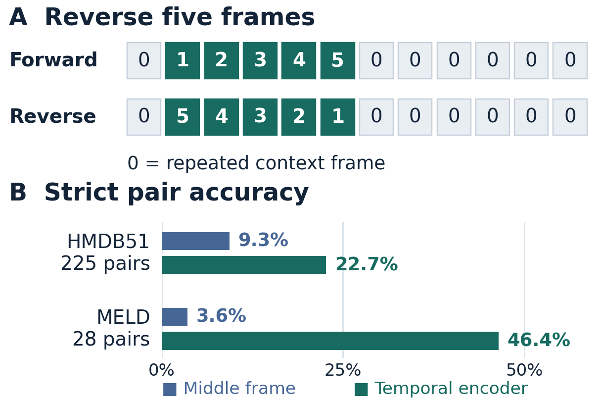
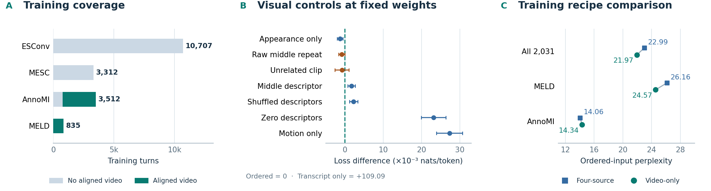
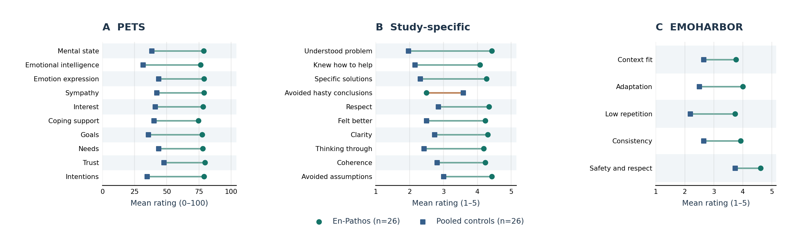

# En-Pathos

This package documents three evaluations of a conversational support system. The temporal diagnostic measures recovery of a constructed edit. The offline adapter scores recorded replies. The live study measures perceived empathy after a conversation.

[Project website](https://cenacchi2000.github.io/en-pathos-research/) · [Download research source and manifests](https://github.com/cenacchi2000/en-pathos-research/raw/refs/heads/main/en-pathos-source.zip) · [Checkpoint hashes and prompt locations](CHECKPOINTS.md)

## Architecture

| Evaluation | Input and model | Output |
| --- | --- | --- |
| Temporal diagnostic | Twelve grayscale slots with a five-frame forward or reversed segment. An independent temporal encoder predicts order and the changed span. | Strict pair accuracy and span recovery |
| Offline reply scoring | Transcript with an optional eight-frame prefix. Pooled appearance and frame differences feed a temporal encoder and rank-eight LoRA on SmolLM2-135M-Instruct. | Reply-token negative log likelihood and perplexity |
| Live recipient study | Transcript, history, pacing flag and optional participant-confirmed cards condition Gemma 4 12B in the intervention. | Post-conversation PETS |

## Results and interpretation

- The temporal encoder achieved 25.3% strict pair accuracy on 253 held-out pairs. The single middle-frame baseline achieved 8.7%. Instance and grounded-pair accuracy were 53.4% and 17.0%, respectively. These results concern constructed edits.
- Of 18,366 adapter training turns, 3,590 had aligned video. On 2,031 held-out video turns, perplexity was 25.64 for transcript input, 22.99 for ordered descriptors, 22.96 for appearance only, and 22.98 for unrelated same-corpus clips. These comparisons hold the trained checkpoint and target replies fixed.
- The live comparison included 52 complete sessions, 26 per arm. Mean PETS was 78.0 for the intervention and 39.8 for pooled controls. The mean difference was 38.2 points (95% CI 28.0–48.3). The live intervention combined group-specific onboarding, pacing and repetition screening. The temporal adapter was scored offline.

## Model and training

| Component | Configuration |
| --- | --- |
| Temporal diagnostic | Twelve 24×24 grayscale frames, signed embedding differences, two temporal convolutions, and a separate span head. The split contains 817 training, 279 validation, and 253 test pairs. |
| Reply backbone | SmolLM2-135M-Instruct, 30 layers, 576-dimensional embeddings. Query and value projections use rank-8 LoRA with alpha 16 and zero dropout. |
| Visual prefix | Eight 32×32 RGB frames. Per-frame features concatenate pooled appearance and absolute frame differences. A 96-channel temporal projection produces eight 576-dimensional prefix embeddings. |
| Optimization | AdamW, learning rate 0.0002, batch size four, one epoch. The four-source and video-only recipes use 4,592 and 898 updates, respectively. |

The mixed run uses **10,707 ESConv**, **3,312 MESC**, **3,512 AnnoMI**, and **835 MELD** turns. Aligned video is available for 2,755 AnnoMI and all 835 MELD training turns. The video-only recipe uses those 3,590 turns and reaches **21.97** ordered-input perplexity on the same held-out video set, versus **22.99** for the four-source recipe. Source mix and training exposure vary together.

## Live model comparisons

| Deployed condition | Complete sessions | Mean PETS (0–100) |
| --- | ---: | ---: |
| En-Pathos with Gemma 4 12B | 26 | **78.0** |
| Gemma 4 12B control | 9 | 44.9 |
| MINT Qwen3-1.7B control | 8 | 35.9 |
| PsyLLM-1.7B control | 9 | 38.2 |
| Pooled controls | 26 | 39.8 |

The same-backbone Gemma difference was **33.1 points** (95% CI **17.0–49.2**). Against pooled controls, PETS total, emotional response, understanding and trust, and perceived repetition all favored En-Pathos at **p < .001**, with Holm adjustment for the three secondary outcomes. The live contrast estimates the deployed bundle. The figure below displays item means and uses the original questionnaire scales.

See the support-card interface

## Reproduce

Unpack `en-pathos-source.zip` into a new directory. Install the Python dependencies listed in code/live/requirements.txt. The live server also uses FFmpeg, a local model endpoint and the configured model weights. Use a fresh ratings database for a local demo. The temporal manifest records source membership and splits. The reply manifests contain hashed source-group and turn identifiers with split and aligned-video flags. The training scripts require prepared records containing transcripts, target replies and descriptors.

Run the temporal trainer with three positional arguments: media directory, MELD annotations, and output directory, plus --manifest manifests/temporal.json. Run the reply trainer with a base checkpoint, prepared JSONL and output directory. For the expanded mixed run add --train-examples 18366 --eval-examples 5154 --epochs 1 --retain-training-video. Exact checkpoint hashes and prompt locations are listed in [CHECKPOINTS.md](CHECKPOINTS.md).

The archive includes implementation code and split metadata. Exact replay also requires the original corpus subsets, checkpoint weights and eligible evaluation records. Participant records and camera footage are excluded.
